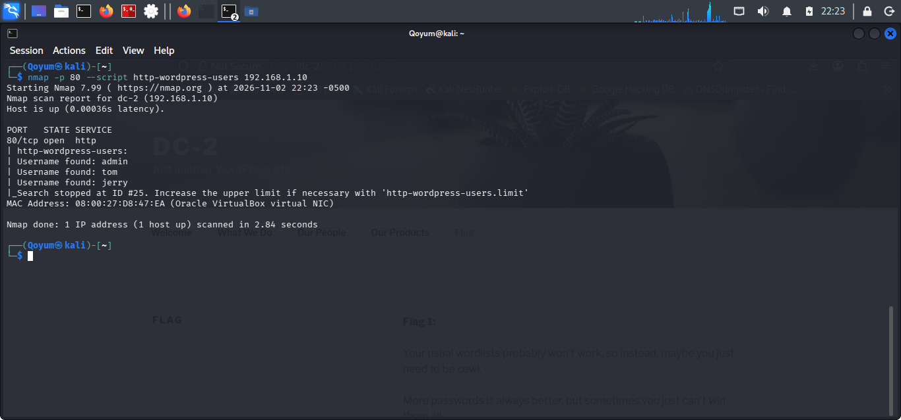

# WordPress User Enumeration

## Objective

Identify usernames associated with the WordPress installation running on DC-2.

## Tool and Command

**Nmap NSE Script**

```bash
sudo nmap -p80 --script http-wordpress-users 192.168.1.10
```

The `http-wordpress-users` script attempts to enumerate WordPress usernames.

## Findings

The scan identified three usernames:

- `admin`
- `tom`
- `jerry`

The script stopped its search at user ID 25.

## Analysis

Identifying valid usernames provided useful information for subsequent password auditing. These accounts were used as input for the next authentication-testing stage.

## Conclusion

Three WordPress usernames were successfully identified, providing a starting point for password auditing.

## Evidence

