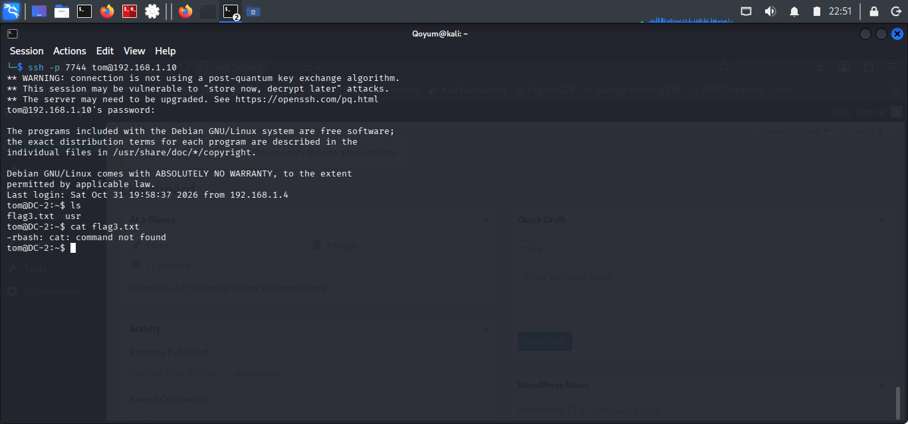

# SSH Initial Access

## Objective

Gain initial access to the DC-2 machine through its exposed SSH service.

## Tool and Command

**SSH**

```bash
ssh tom@192.168.1.10 -p 7744
```

## Findings

- Successfully authenticated as `tom`.
- SSH access was established on port `7744`.
- The session opened in a restricted Bash shell (`rbash`).

## Analysis

The credentials discovered during WordPress password auditing were also accepted by SSH, demonstrating password reuse across services.

Although access was obtained, the restricted shell limited available commands and required further investigation.

## Conclusion

Initial access to DC-2 was successfully achieved through SSH using Tom's credentials. The restricted shell became the next obstacle to investigate.

## Evidence

