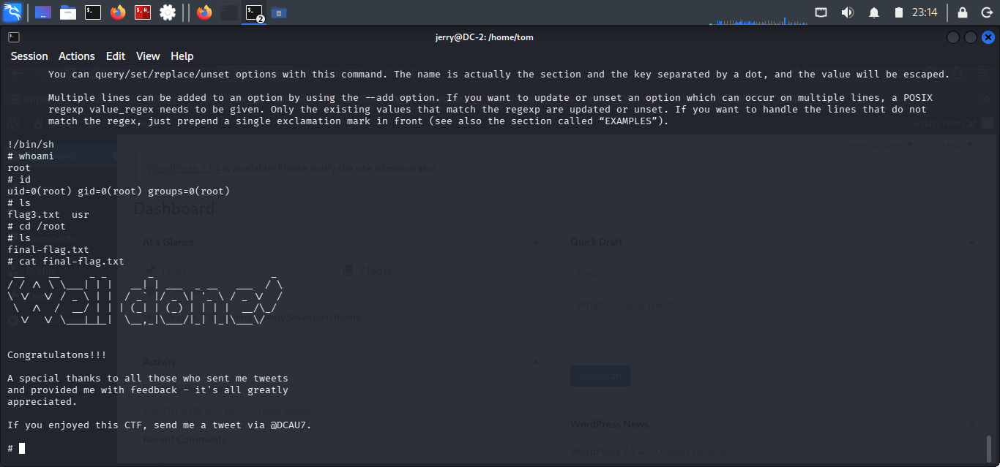

# Final Flag Retrieval

## Objective

Verify root access and retrieve the final flag to confirm successful completion of the DC-2 challenge.

## Commands Executed

```bash
cd /root
ls
cat final-flag.txt
```

## Findings

- Successfully accessed the `/root` directory.
- Located and retrieved `final-flag.txt`.
- The file displayed the challenge's congratulatory message.

## Conclusion

The final flag was successfully retrieved, confirming complete compromise of the DC-2 virtual machine and successful completion of the assessment.

## Evidence

