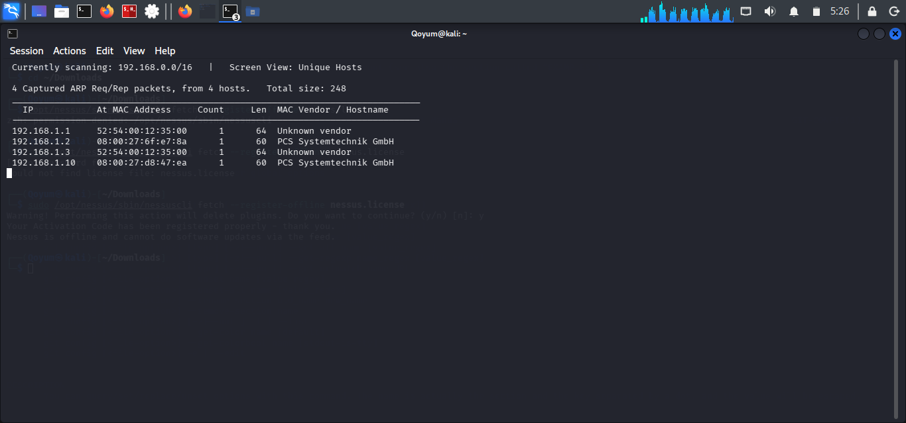

# Network Discovery

## Objective

Identify the DC-2 virtual machine on the local lab network and determine its IP address.

## Tool and Command

**Netdiscover**

```bash
sudo netdiscover
```

Netdiscover uses ARP requests to identify active devices on a local network.

## Findings

- **Target IP:** `192.168.1.10`
- **MAC Address:** `08:00:27:D8:47:EA`
- **Vendor:** Oracle VirtualBox

## Analysis

The discovered IP address was used as the target for subsequent Nmap scans. Although Nmap can also perform host discovery, Netdiscover was used for the initial ARP-based identification.

## Conclusion

The DC-2 virtual machine was successfully identified on the lab network.

## Evidence

