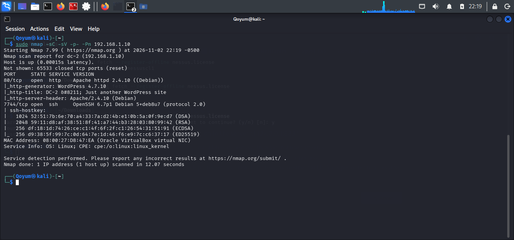

# Nmap Scanning

## Objective

Identify open ports, running services, and version information on the DC-2 target.

## Tool and Command

**Nmap**

```bash
nmap -sC -sV -Pn -p- 192.168.1.10
```

- `-sC`: Runs default NSE scripts.
- `-sV`: Detects service versions.
- `-Pn`: Skips host discovery.
- `-p-`: Scans all TCP ports.

## Findings

| Port | Service | Version |
|---|---|---|
| `80/tcp` | HTTP | Apache 2.4.10 (Debian) |
| `7744/tcp` | SSH | OpenSSH 6.7p1 (Debian) |

Additional information:
- **Web Application:** WordPress 4.7.10
- **Operating System:** Linux (as indicated by Nmap's service fingerprinting).

## Analysis

Two open TCP ports were identified. Port 80 hosts a WordPress website, while SSH runs on port 7744 instead of its conventional port 22.

The findings provided two services for further investigation and demonstrated the importance of scanning all TCP ports.

## Conclusion

The scan identified the exposed services and technologies, providing direction for the enumeration phase.

## Evidence

